<!-- The images below are generated by readme-gen/ (shadcn/ui + Bklit UI rendered to SVG) and refreshed daily by .github/workflows/readme.yml. -->

<picture>
  <source media="(prefers-color-scheme: dark)" srcset="assets/hero-dark.svg">
  
</picture>

  
  
  

## Projects

<a href="https://github.com/Sym-jay/clishe"><picture>
  <source media="(prefers-color-scheme: dark)" srcset="assets/project-clishe-dark.svg">
  
</picture></a>
<a href="https://github.com/Sym-jay/Blot"><picture>
  <source media="(prefers-color-scheme: dark)" srcset="assets/project-blot-dark.svg">
  
</picture></a>
<a href="https://github.com/Sym-jay/polyphage"><picture>
  <source media="(prefers-color-scheme: dark)" srcset="assets/project-polyphage-dark.svg">
  
</picture></a>
<a href="https://github.com/Sym-jay/WildID"><picture>
  <source media="(prefers-color-scheme: dark)" srcset="assets/project-wildid-dark.svg">
  
</picture></a>

<b>More about each project</b>

**[Clishe](https://github.com/Sym-jay/clishe)** is an offline-first command-line companion for Linux beginners.
Type plain English, see the exact command before it runs, and learn the shell as you go. AI is optional and
runs locally through Ollama. It has safety checks on every command, a fuzz-tested danger classifier,
`undo that` for accidental deletions, bundled tldr-pages, screen-reader mode, shell completions and a man page.

**[Blot](https://github.com/Sym-jay/Blot)** warns you before you commit when a change removes code that was
added to fix a bug, brings back a line a fix deliberately removed, or forgets a file that almost always
changes alongside. It runs locally, needs no account or AI, and stays quiet unless the history gives it a
real reason to speak. Sora, the slime in the header, is its mascot.

**[Polyphage](https://github.com/Sym-jay/polyphage)** has ProteinMPNN propose sequences against a fixed
backbone with the catalytic triad frozen, ThermoMPNN price the stability cost of each mutation, and NSGA-II
return a Pareto front instead of a single "best" answer. It recovers D186H, a published FAST-PETase
mutation, with no access to the paper. An earlier headline result that did not reproduce was withdrawn
and documented rather than quietly dropped.

**[WildID](https://github.com/Sym-jay/WildID)** uses EfficientNet-B0 as the primary classifier, with a
ResNet-50 + MobileNet-V3 weighted-vote ensemble and automatic fallback. It has offline caching, confidence
scoring, IUCN Red List links and life lists.

## Activity

<picture>
  <source media="(prefers-color-scheme: dark)" srcset="assets/heatmap-dark.svg">
  
</picture>

<picture>
  <source media="(prefers-color-scheme: dark)" srcset="assets/activity-dark.svg">
  
</picture>

<picture>
  <source media="(prefers-color-scheme: dark)" srcset="assets/stats-dark.svg">
  
</picture>
<picture>
  <source media="(prefers-color-scheme: dark)" srcset="assets/languages-dark.svg">
  
</picture>

<picture>
  <source media="(prefers-color-scheme: dark)" srcset="assets/prs-sankey-dark.svg">
  
</picture>

Upstream contributions include a FAISS vector database and RAG integration for
[harryfrzz/neo](https://github.com/harryfrzz/neo/pulls?q=author%3ASym-jay),
Estonian language support for [seerr](https://github.com/seerr-team/seerr/pulls?q=author%3ASym-jay),
and documentation work on [harryfrzz/re-tui](https://github.com/harryfrzz/re-tui/pulls?q=author%3ASym-jay).

## Tools

`Python` `TypeScript` `Go` `Dart` `Rust` `Bash` &nbsp;·&nbsp;
`PyTorch` `FastAPI` `Flutter` `React` `Node.js` &nbsp;·&nbsp;
`Docker` `Git` `Linux`

---

  <a href="mailto:shyam.kjay.10a@gmail.com">shyam.kjay.10a@gmail.com</a> &nbsp;·&nbsp; <a href="https://www.linkedin.com/in/shyam-jayasankar-5bb90b292/">LinkedIn</a> &nbsp;·&nbsp; India &nbsp;·&nbsp; Charts built with <a href="https://ui.shadcn.com">shadcn/ui</a> and <a href="https://bklit.com">Bklit UI</a>

